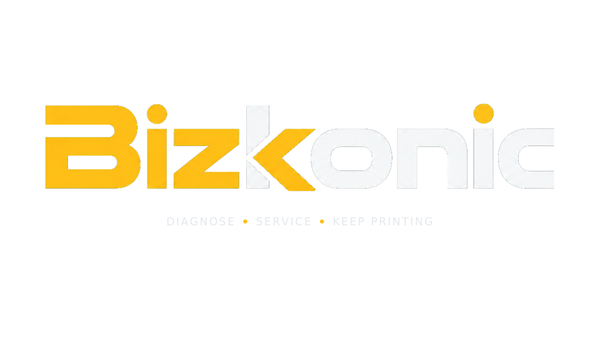

<p align="center"></p>

# Bizkonic

### See the next step more clearly.

An independent service-reference companion for supported Konica Minolta printers and multifunction devices. Designed and developed by **Alireza Rajabi**, based in Montréal, Canada.

[Explore Bizkonic](https://bizkonic.com/) · [About the creator](https://alirezarajabi.com/) · [Contact support](mailto:support@bizkonic.com)

## The problem it addresses

A service code is only useful when it is matched to the right device and reference. Searching scattered documents takes time, and an explanation for a similar model may not apply to the device in front of you.

Bizkonic brings model-specific references into a practical workflow: **choose the model, find the code, review the relevant next steps and source.**

## What Bizkonic brings together

| Work area | Purpose |
| --- | --- |
| Service Errors | Model-specific explanations, troubleshooting references and source links. |
| Load Check | Device-section and unit references for supported models. |
| Network Errors | Communication-code explanations from the relevant reference. |
| Service Settings | Verified settings and adjustment references where available. |
| Consumables | Supported toner, drum and developer identifiers where verified. |

The interface and explanations support **English, French and Farsi**. Technical identifiers remain exact; original reference tables may remain in English.

The **23 October 2026 product brochure** lists 68 model profiles: 63 office and 5 Production / Industrial. A model profile does not imply complete coverage of every work area. Advanced access is reviewed separately. Visit the official site for current availability and demo requests.

## What is in this repository

This is a **project showcase with a standalone illustrative code sample**. It is not the Bizkonic application source, a downloadable edition of the app, or a copy of its reference database.

The sample demonstrates one narrow engineering idea relevant to the product: **look up a reference by exact model and code, with explicit language fallback and ambiguity handling.** It was written separately for this showcase and is not extracted from production code.

- Synthetic models and codes only. No manufacturer manual content.
- Explicit `found`, `not_found` and `ambiguous` results.
- English, French and Farsi example text; a visible fallback flag when a translation is absent.
- Input and dataset validation, isolated result copies and automated tests.
- No dependencies, network calls, credentials, accounts or device commands.

## Try the sample

With Node.js 22 or newer installed:

```sh
node test/lookup.test.mjs
node sample/demo.mjs
```

No package installation is needed. Both commands run locally. If npm is available, `npm test` and `npm run demo` are equivalent shortcuts.

```js
import { createLookup } from './sample/lookup.mjs';
import { demoRecords } from './sample/demo-data.mjs';

const lookup = createLookup(demoRecords);
const result = lookup({
  model: 'DEMO-A',
  code: 'DEMO-001',
  language: 'fr'
});

console.log(result.status);       // found
console.log(result.languageUsed); // fr
console.log(result.fallback);     // false
```

`DEMO-A` and `DEMO-001` are fictional. The sample cannot diagnose or service a real machine. See [sample design and limitations](docs/SAMPLE-DESIGN.md) for the contract and scope.

## Project structure

```text
assets/                    Existing Bizkonic logo
docs/SAMPLE-DESIGN.md       Sample contract and design decisions
sample/lookup.mjs          Exact-model lookup logic
sample/demo-data.mjs       Fictional multilingual records
sample/demo.mjs            Runnable demonstration
test/lookup.test.mjs       Automated behavior tests
```

## Creator and contact

**Alireza Rajabi** designs and develops Bizkonic, with a focus on practical tools for technical support.

- Product and demo information: [bizkonic.com](https://bizkonic.com/)
- Personal website: [alirezarajabi.com](https://alirezarajabi.com/)
- Support: [support@bizkonic.com](mailto:support@bizkonic.com)

Bizkonic is an independent project. Manufacturer names identify supported equipment and do not imply affiliation or endorsement.

## Source and rights

The full application's source, production data, access controls and deployment configuration remain private and are not included here. This showcase does not grant a license to the application, its reference data or its branding. No open-source license is granted for this draft. See [NOTICE](NOTICE).
